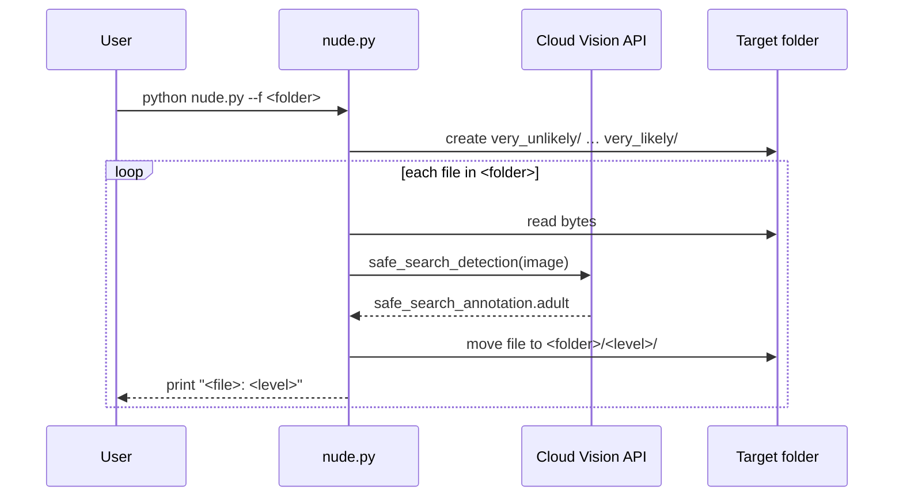

# nude-detector

A small Python CLI that sorts the images in a folder into sub-folders by their adult-content likelihood, using Google Cloud Vision SafeSearch.

## Overview

`nude.py` sends every file in a folder to the Cloud Vision API's
[SafeSearch detection](https://cloud.google.com/vision/docs/detecting-safe-search), reads the `adult` likelihood
(`VERY_UNLIKELY` … `VERY_LIKELY`) and **moves** each image into a sub-folder named after that level. It is useful for
quickly triaging a large folder of images before manual review.

## Features

- One SafeSearch request per file; a single Vision client is reused for the whole run.
- Creates five destination folders inside the target folder: `very_unlikely`, `unlikely`, `possible`, `likely`,
  `very_likely`.
- Moves each processed file into its folder and prints `<filename>: <level>`.
- Target folder is set with `--f` (defaults to the current directory).
- Only top-level files are processed; sub-folders are ignored.

## Architecture



## Requirements

- Python 3.7+
- `google-cloud-vision` (there is no `requirements.txt`)
- A Google Cloud project with the Vision API enabled and a service account JSON key that can call it

## Installation and quick start

```bash
git clone https://github.com/Lapeyus/nude-detector.git
cd nude-detector
python -m venv .venv && source .venv/bin/activate
pip install google-cloud-vision

# Place the service account key next to where you run the script:
cp /path/to/service-account.json ./credentials.json

python nude.py --f /path/to/images
```

## Usage

```bash
python nude.py               # process files in the current directory
python nude.py --f ./photos  # process files in ./photos
```

Example output:

```text
img_001.jpg: very_unlikely
img_002.jpg: possible
```

Files are **moved**, not copied. Work on a copy of the folder if you need to keep the original layout.

## Repository structure

```text
nude-detector/
├── nude.py                  # The whole tool: argument parsing, folder setup, SafeSearch call, file moves
├── .pre-commit-config.yaml  # Generic pre-commit hooks (large files, JSON, merge conflicts, symlinks, ...)
├── .gitignore
├── LICENSE                  # Apache License 2.0
└── README.md
```

## Configuration

- **Credentials:** the script sets `GOOGLE_APPLICATION_CREDENTIALS=credentials.json` at import time, overriding any value
  already in your environment. The key file must be named `credentials.json` and live in the **current working
  directory**. Never commit it; add it to `.gitignore`.
- No other settings; the only CLI flag is `--f`.

## Tests

There are no automated tests. Running the script requires real Google Cloud credentials and incurs Vision API usage.

## Project status

Small utility, not actively developed. Two commits, the last on 2023-09-25.

## Known limitations

- Every regular file in the folder is sent to the API, including non-images; a non-image file makes the request fail
  and stops the run (no error handling).
- If the API returns `UNKNOWN`, the script tries to move the file to an `unknown/` folder that it never creates, which
  raises an error.
- Only the `adult` category is used; `racy`, `violence`, `medical` and `spoof` are ignored.
- Requests are sequential; large folders are slow.
- The hard-coded `credentials.json` path cannot be changed without editing the script.

## License

Apache License 2.0. See [LICENSE](LICENSE).
